# Remo Montalbano: AI project showcase

Screenshots and a short video of four tools I built with AI coding agents. I set the goals, chose the priorities, reviewed the results and directed each round of changes; agents wrote the code. The source repositories are private, so this repo shows the interfaces only.

These are personal projects, not official Cisco products. Every screenshot shows the real interface running locally. Except for the AI Engineer Atlas, which shows public YouTube talks, all data on screen is invented sample data.

## AI Engineer Atlas

A research guide to the talks on the AI Engineer YouTube channel. Each talk is analysed and scored, grouped into themes and courses, and published as a website that readers can search and explore.

Role: directed AI-assisted development. Status: working.

**Click-through demo:** download [`ai-engineer-atlas/demo.html`](ai-engineer-atlas/demo.html) and open it in a browser. It is a static snapshot of three real pages (Start, Topics, Map). The links between those pages work; other controls do not.

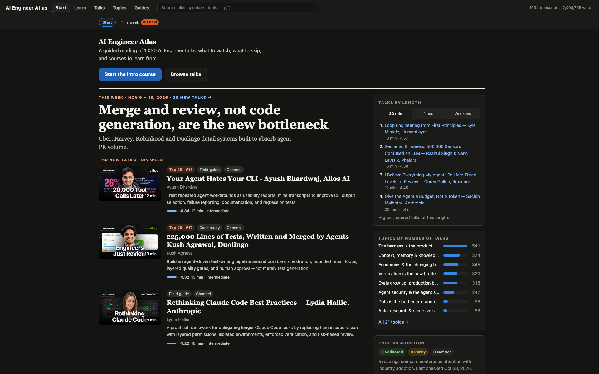

| | |
|---|---|
| 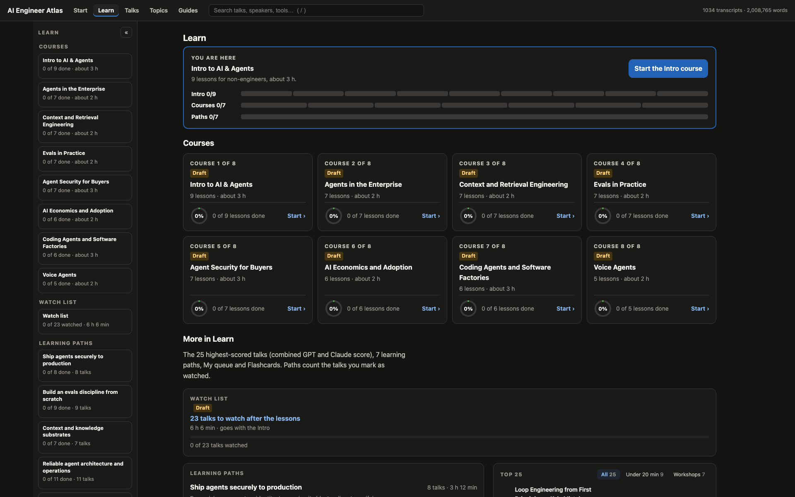 | 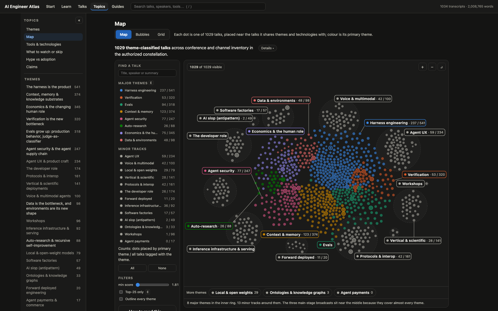 |

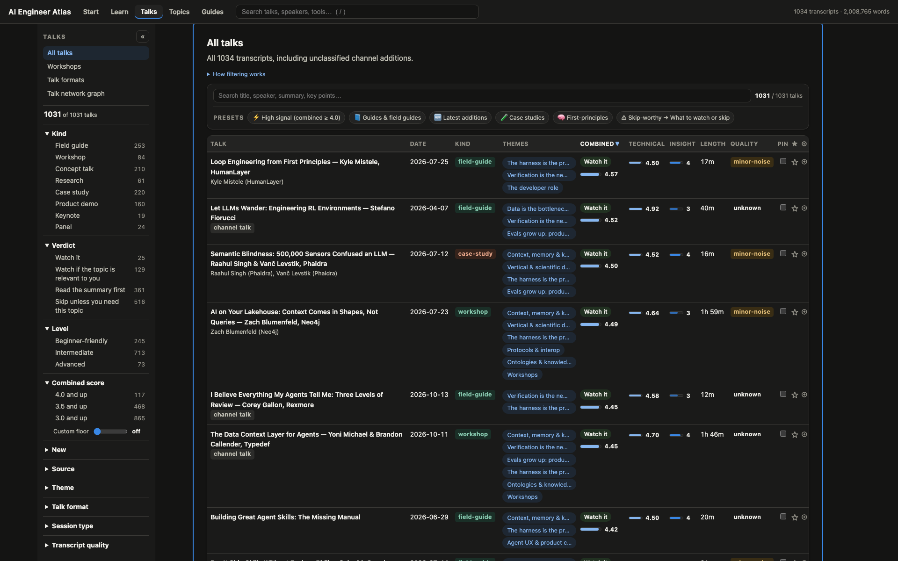

## CiscoReadyReader

A local tool that turns a Cisco Ready "Customer Detail Report" export into dashboards for coverage, lifecycle risk, renewals and changes between reports. It runs on one machine and makes no outbound calls.

It also has an optional chat feature, off by default, that can use either the Cisco Circuit API or a local model through Ollama. The chat is not shown in these screenshots.

Role: directed AI-assisted development. Status: working. The customer shown, Lakeshore Community College District, is a synthetic fixture: every organisation, address and contract in it is made up.

**Click-through demo:** download [`cisco-ready-reader/demo.html`](cisco-ready-reader/demo.html) and open it in a browser. It is a static snapshot of three real pages (Overview, Org explorer, Lifecycle and risk). The sidebar links between those pages work; other controls do not.

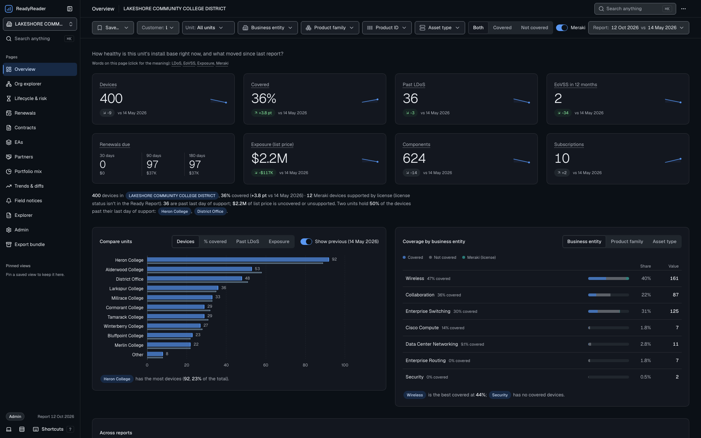

| | |
|---|---|
| 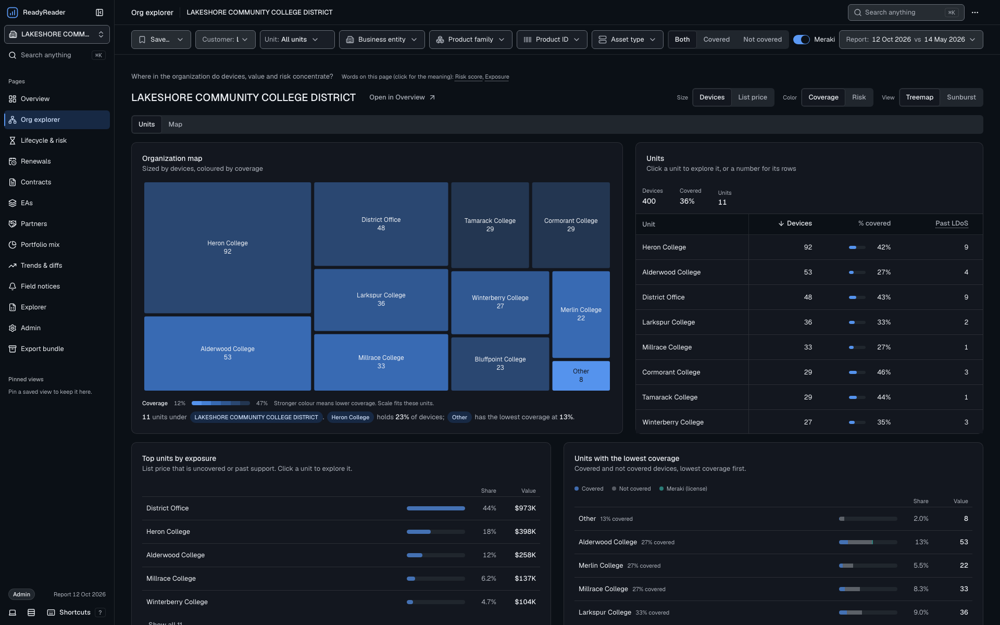 | 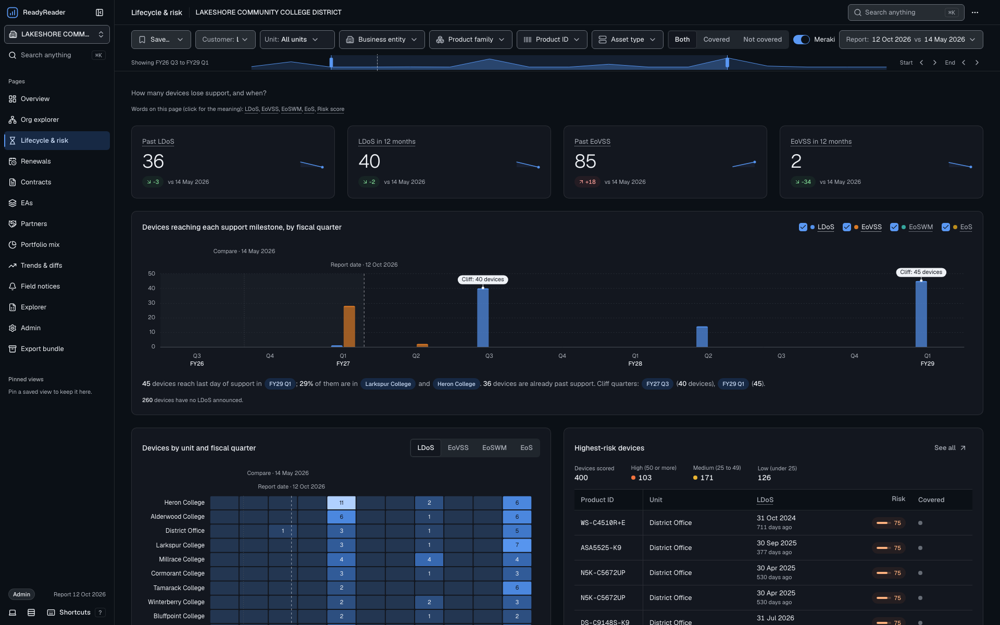 |

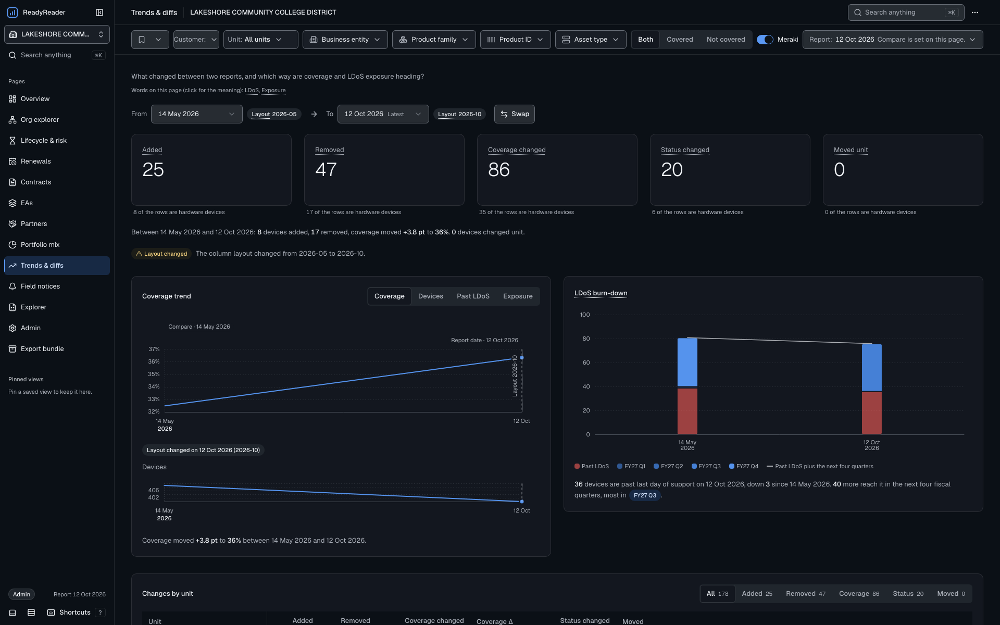

## Personal CRM

A private, local CRM that ships as one HTML file. It keeps accounts, contacts, segments, templates and campaigns in a folder the owner picks, prepares emails without sending them, and makes no network requests.

Role: directed AI-assisted development. Status: working. The accounts and people shown are the app's built-in sample data.

**Click-through demo:** download [`personal-crm/demo.html`](personal-crm/demo.html) and open it in a browser. It is a static snapshot of five real pages (Home, Accounts, Contacts, Campaigns, Suggestions). The sidebar links between those pages work; other controls do not.

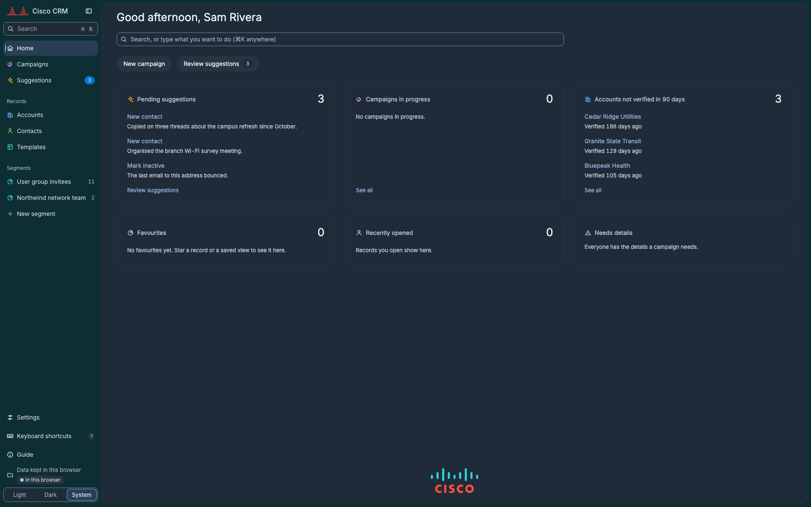

| | |
|---|---|
| 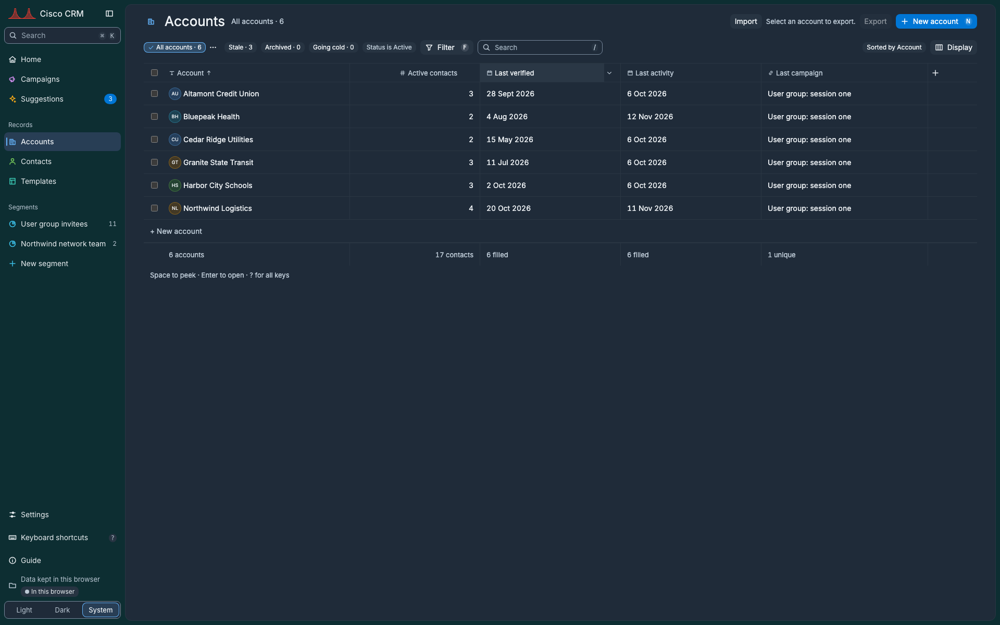 | 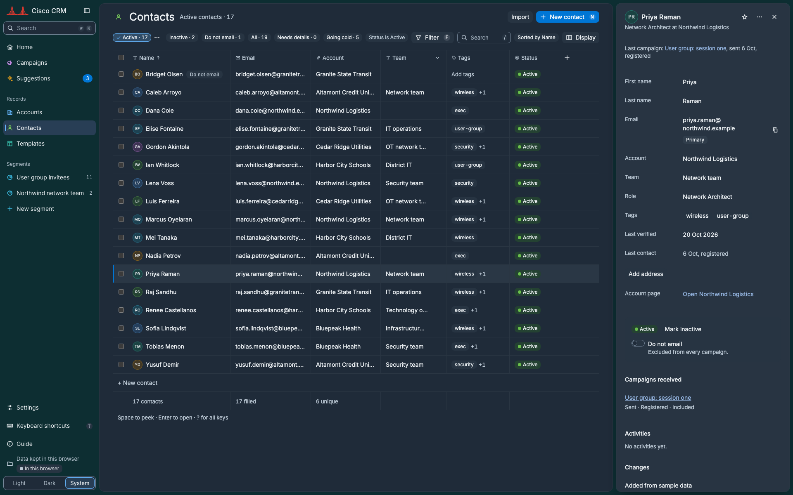 |

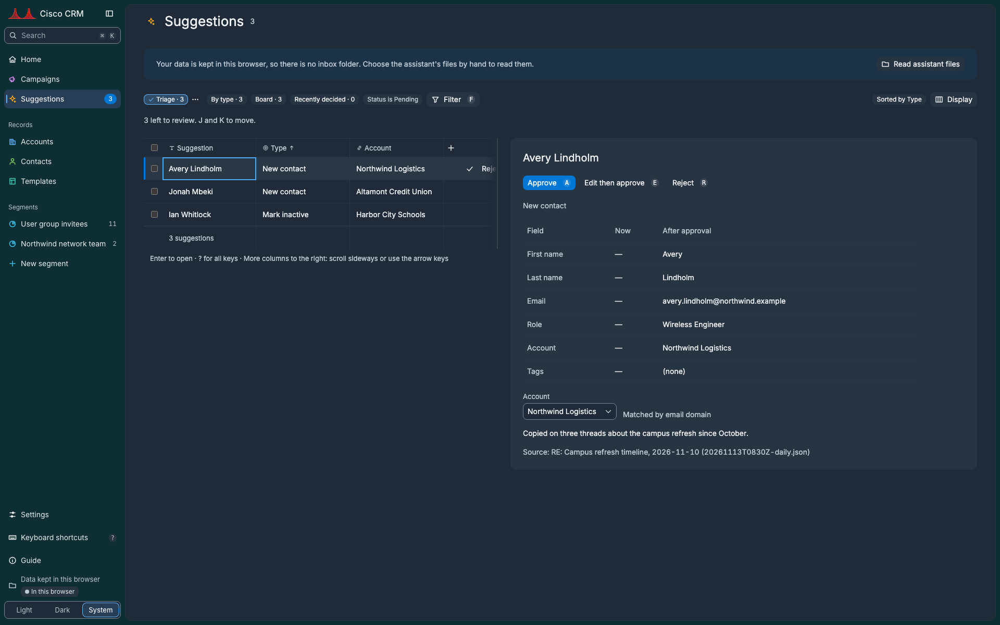

## My Agent Dashboard

A page that ranks an SE's email and chat threads by how long people have been waiting, and tracks promises made, threads gone quiet and open support cases. The video is a 1 minute 36 second animated walkthrough, made with Manim and a generated voice-over.

Role: directed AI-assisted development of the video. The names in it are invented.

[Watch the video (MP4, 19 MB)](myagent-dashboard/myagent-dashboard-highlight-1080p.mp4)

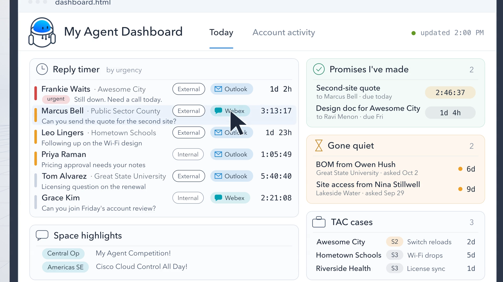
